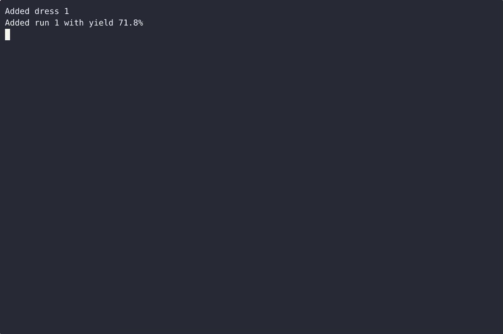
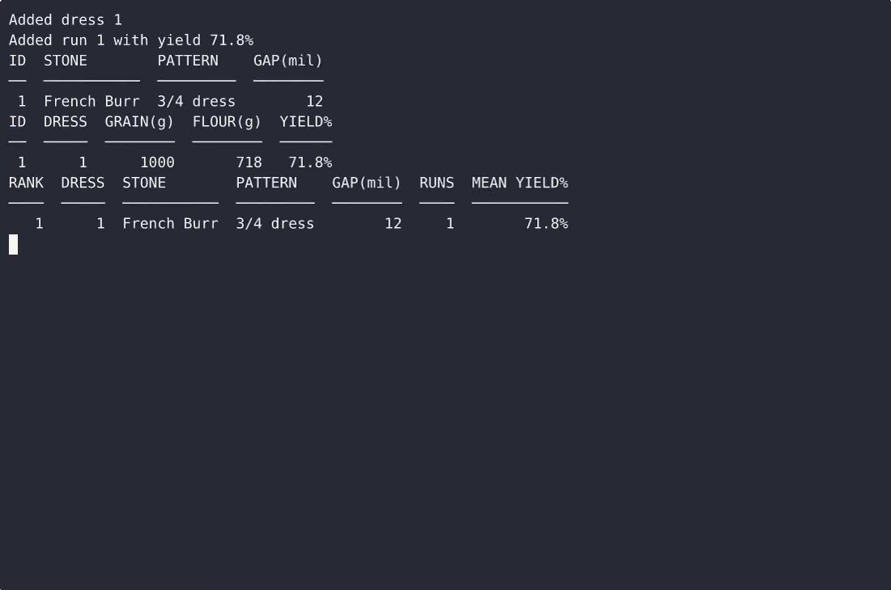

# GristMill — complete Full-stack app command-line tool example app

Clone it. Run it. Own it. **GristMill** is a complete, Apache-2.0-licensed command-line tool in Full-stack app — full source, demo data included. GristMill is a single-file, standard-library Python CLI for a small mill: it stores burr stone dress settings (stone, pattern, gap in thousandths), logs each grind run with grain-in and flour-out weights so the flour…. Self-host GristMill on your own infrastructure, or open it on [cenius.ai](https://cenius.ai/marketplace/p/gristmill?ref=gh&utm_campaign=gristmill-webapp) to request changes and get a GristMill fresh build.


[](LICENSE)  [](https://cenius.ai)

[](https://cenius.ai/marketplace/p/gristmill?ref=gh&utm_campaign=gristmill-webapp)

> **▶ [Open & edit in cenius.ai](https://cenius.ai/marketplace/p/gristmill?ref=gh&utm_campaign=gristmill-webapp)** — one click to an editable workspace: describe changes in plain English, get an instant preview, one-click deploy and host. Modifications made on the platform come with full rebrand & relicense rights.

_Local clone? See [Quick start](#quick-start) below. cenius.ai is the zero-setup path._

## Demo


▶ **[Watch the full demo video](https://cenius.ai/marketplace/p/gristmill?ref=gh&utm_campaign=gristmill-webapp)** — the complete walkthrough, playing on the project's cenius.ai page · [MP4 file](.github/media/demo.mp4)

## Screenshots

 

## Quick start

```bash
./install.sh   # installs dependencies + seeds demo data
```

See [`INSTALL.md`](INSTALL.md) for full setup and usage instructions.

## Features

- Track burr stone dress pattern and gap settings
- Record flour yield per grind run
- Compare yields across dress settings

## Architecture

Open the repo and you'll find a complete Full-stack app application (22 files). One command (`./install.sh`) covers dependency setup and demo-data seeding. Installation walkthrough: [`INSTALL.md`](INSTALL.md).

## Usage guide

Walkthroughs of what the tool actually does. Run the tool as
`python3 gristmill.py …` (or `python3 main.py …`) from the project directory.

### 1. Set up a dress setting

A dress setting is the stone + dress pattern + gap combination you grind on.
Record it once and point every run at it.

```bash
$ python3 gristmill.py dress add --stone "French Burr" --pattern "3/4 dress" --gap 12
Added dress 1

$ python3 gristmill.py dress add --stone "French Burr" --pattern "fine dress" --gap 8
Added dress 2

$ python3 gristmill.py dress list
ID  STONE        PATTERN     GAP(mil)
──  ───────────  ──────────  ────────
 1  French Burr  3/4 dress         12
 2  French Burr  fine dress         8
```

Gaps are whole thousandths of an inch and must be positive. A zero, negative
or non-integer gap is rejected before anything is written:

```bash
$ python3 gristmill.py dress add --stone Peak --pattern fine --gap 0
gristmill: gap must be a positive whole number of thousandths of an inch (got 0)
$ echo $?
2
```

With no settings yet, `dress list` prints one guidance line and exits 0:

```bash
$ python3 gristmill.py dress list
No dress settings yet — add one with: gristmill dress add --stone <name> --pattern <name> --gap <mil>
```

### 2. Log a grind run

Weigh the grain in and the flour out; GristMill computes and stores the yield.

```bash
$ python3 gristmill.py run add --dress 1 --grain-g 1000 --flour-g 718
Added run 1 with yield 71.8%

$ python3 gristmill.py run add --dress 2 --grain-g 1000 --flour-g 762
Added run 2 with yield 76.2%

_Full guide: [`USAGE.md`](USAGE.md)_

## FAQ

### What does it take to self-host GristMill?

Everything you need ships in this repo: clone it, run `./install.sh` to install dependencies and seed demo data, then follow [`INSTALL.md`](INSTALL.md) to start it. No external services required.

### Is white-labeling GristMill allowed?

Yes. The MIT license lets you remove the original branding and ship under your own name. For a guided approach, [remix it on cenius.ai](https://cenius.ai/marketplace/p/gristmill?ref=gh&utm_campaign=gristmill-webapp): you get a fresh build with full rebrand and relicense rights.

### What technologies are in GristMill's stack?

Full-stack app end-to-end. Every file you need to run the app is here in this repository — code, configuration, seed data. Highlights include track burr stone dress pattern and gap settings.

### What if I want to add features to GristMill without coding?

The easiest route: [visit the project on cenius.ai](https://cenius.ai/marketplace/p/gristmill?ref=gh&utm_campaign=gristmill-webapp), tell the platform what to change, and collect the updated build. No source-editing needed.

### What license does GristMill use?

Yes — it ships under the Apache-2.0 license, which permits commercial use, modification and redistribution. The full text is in [LICENSE](LICENSE).

## License & rebranding

Released under the [Apache License 2.0](LICENSE) (© 2026 Cenius AI) — free for personal and commercial use. The Cenius name/logo are trademarks (see NOTICE).

**Need a customized version?** [Remix this app on cenius.ai](https://cenius.ai/marketplace/p/gristmill?ref=gh&utm_campaign=gristmill-webapp) — modifications made on the platform come with **full rebrand & relicense rights** over your derivative.

## Built with cenius.ai

This entire application — code, design, seeded demo data — was generated on **[cenius.ai](https://cenius.ai)** from a plain-English description.

- 🚀 [Build your own app on cenius.ai](https://cenius.ai)
- 🎛️ [Remix GristMill on the marketplace](https://cenius.ai/marketplace/p/gristmill?ref=gh&utm_campaign=gristmill-webapp) — open it in a workspace, prompt for changes, and ship your own version.

More open-source apps: [the Cenius-ai catalog](https://github.com/Cenius-ai) · [showcase index](https://github.com/Cenius-ai/showcase)
